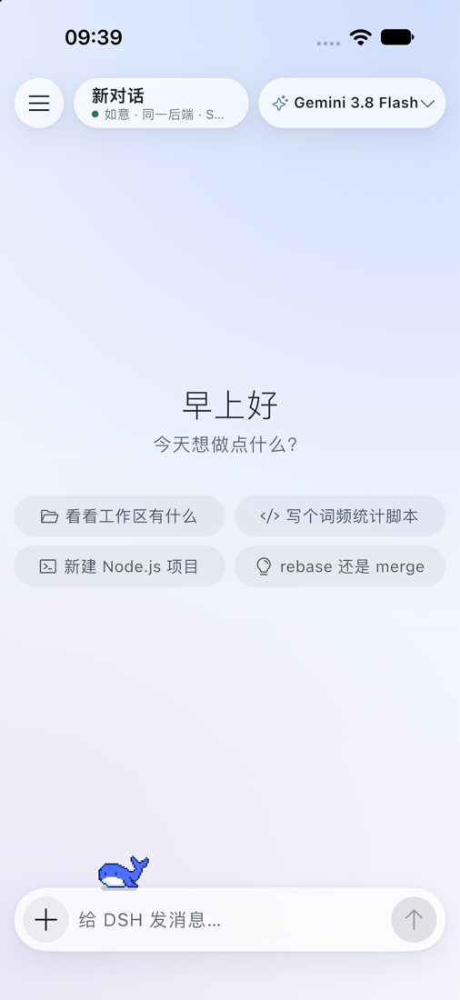
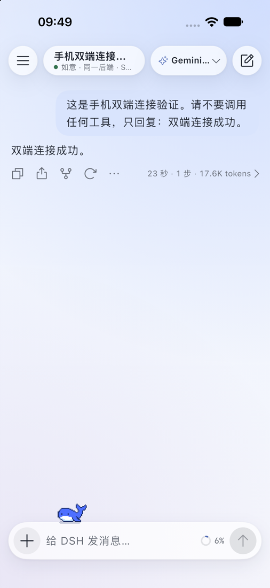
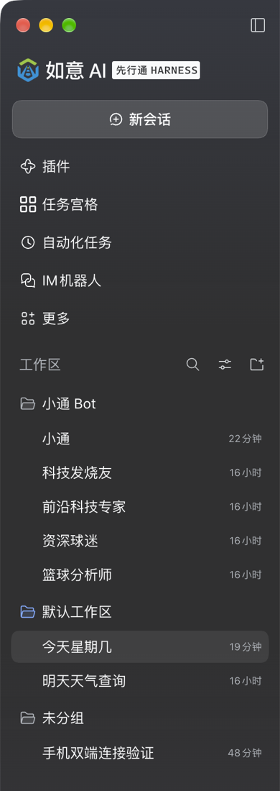

# dsh-Go iOS 远程客户端与如意同后端连接：交接文档

- 更新日期：2026-11-07（验证完成于当天上午）
- 读者：在其他终端接手本仓库的智能体、开发者
- 文档性质：实际实施记录 + 可复现操作手册；不是“已完成真机发布”的说明

## 0. 接手前必须知道的结论

1. 用户要的是 **手机原生界面操作电脑如意正在运行的同一个后端**，不是屏幕投影，也不是另起引擎共享历史文件。
2. iOS 定位为远程客户端：不运行 Android 的 PRoot/rootfs，不提供 Android 手机操控通道。
3. 当前 iOS 模拟器已显示原生聊天界面，连接如意原进程，并能显示真实模型回复“双端连接成功。”。
4. 本次通过两个 Dart 客户端验证了同后端的实时用户消息、助手消息及正常 turn 完成。没有自动点击桌面如意窗口确认视觉刷新。
5. **当前模拟器安装的是 `lib/dev/desktop_attach_preview.dart` 验证入口，不是 `lib/main.dart` 正式入口。它直接通过同机 Unix socket 配对，再走回环 HTTP/WebSocket；没有经过 SSH。**
6. 正常 App 已增加 SSH `attach` 模式及界面，相关单测通过；真实 iPhone 的 SSH 配对、签名安装、后台恢复尚未验收。
7. 改动已提交到 `ios-ruyi-handoff` 并推送到内网 GitLab（详见 0.1）。**`main` 仍是基线 `d44f960`，不含本功能；上游 GitHub 仓库也未收到本功能。**
8. **运行截图见 9.5 节**（`docs/assets/ios-ruyi/`）：iOS 原生界面接入、真实回复、如意桌面端会话列表、配对失败页。桌面端原图含真实姓名与个人对话，**已裁切，未入库**。
8. 本文不包含 API Key、启动 token、Cookie、SSH 私钥。禁止把这些内容加入交接文档、普通日志或 Git。

## 0.1 代码仓库与移交方式（先看这一节）

| 项目 | 值 |
|---|---|
| 交付仓库（内网 GitLab） | `ssh://git@10.10.117.12:2222/xxt/ai-server/ai-ruyi-app.git` |
| Web 界面 | `http://10.10.117.12:8888/xxt/ai-server/ai-ruyi-app` |
| 上游原仓库 | `https://github.com/ccch1mneyyy/dsh-Go.git`（本功能未推送到此） |
| 基线提交 | `d44f9607b69bc284a733e554805f283b30471e7a`（2026-11-02） |
| `main` 分支 | 等于基线 `d44f960`，**不含本功能** |
| 功能分支 | `ios-ruyi-handoff`，已推送，含全部改动 |
| 主机指纹 | `[10.10.117.12]:2222` ED25519 `SHA256:fCaX/c8Cf3t86XqUAm/o2OMwJ10ccB8DGdKtRlG3T3E` |
| 备用移交补丁 | `docs/ios-ruyi-handoff-2026-11-07.patch`，约 1.5 MB，84 个文件（不入 git） |
| 完整性校验 | 移交方在交付时告知 SHA-256；接收方用 `shasum -a 256` 比对 |

**注意到这一点：`main` 是基线，功能在 `ios-ruyi-handoff`。** 直接 clone `main` 拿不到本功能。

## 0.2 取得代码

优先用功能分支：

```bash
git clone ssh://git@10.10.117.12:2222/xxt/ai-server/ai-ruyi-app.git
cd ai-ruyi-app
git switch ios-ruyi-handoff
git log -1 --oneline            # 应为 docs: add iOS and desktop run screenshots
git status --short              # 应为空
```

若网络访问不了内网 GitLab，才用离线补丁（以基线为父提交生成）：

```bash
git clone https://github.com/ccch1mneyyy/dsh-Go.git
cd dsh-Go
git checkout d44f9607b69bc284a733e554805f283b30471e7a
git apply --check /path/to/ios-ruyi-handoff-2026-11-07.patch   # 仅检查
git apply /path/to/ios-ruyi-handoff-2026-11-07.patch
```

补丁说明：

- 补丁与 `d44f960..ios-ruyi-handoff` 等价，已在本机干净克隆上验证可应用。
- 不含 `app/ios/Pods`（约 1 GB）、`build/`、`.dart_tool/`、`.workbuddy/` 与任何凭据；这些在目标机由 `flutter pub get`、`pod install` 重新生成。
- 含 `app/ios/` 工程源文件（53 个），这是仓库原先缺失的 iOS 平台工程。
- 含 `docs/assets/ios-ruyi/` 的 4 张运行截图。
- 补丁文件本身**不入 git**，避免与提交内容重复。
- 若上游 `main` 已前进导致冲突，先确认冲突文件归属再手工合并；**不要 `git apply --3way` 强推后声称验证通过**，也不要 `git checkout -- .` 丢弃改动。

`main` 是否要合并本功能（发 MR）由用户和评审决定；不要未经要求把功能分支合进 `main` 或推送到上游 GitHub 仓库。

**不要移交的内容**：`~/.xianxingtong`（用户数据与凭据）、`~/.dsh`、SSH 私钥、任何启动 token/Cookie、`app/build`、`app/.dart_tool`、`app/ios/Pods`。

## 1. 三种连接方式必须区分

| 方式 | 后端 | 是否符合本次需求 | 状态 |
|---|---|---|---|
| 默认 SSH `managed`，执行 `dsh web` | App 管理的独立引擎 | 否，未必是如意进程 | 原有能力保留 |
| `DSH_HOME=~/.xianxingtong dsh web` | 第二个引擎，共用如意文件 | 否，共用文件不等于运行状态同步，存在锁/双写风险 | 早期尝试，不作为最终方案 |
| SSH `attach`／模拟器同机直连 | 如意已有 Host | 是 | 同机直连已实测；SSH attach 单测通过 |

正确链路：

```text
正常真机：手机原生 UI → SSH 加密隧道 → Mac 回环 HTTP/WebSocket → 如意现有 Host
当前演示：iOS 模拟器原生 UI → Mac 回环 HTTP/WebSocket → 如意现有 Host
授权来源：如意 Host 内 opt-in 插件 → owner-only Unix socket → 本机用户授权客户端
```

`~/.dsh` 和 `~/.xianxingtong` 是不同产品数据目录。不要把二者软链、复制会话或改工作区索引当成双端适配。

## 2. 本机环境快照（不要跨机器照抄）

| 项目 | 本次实际值 |
|---|---|
| 项目根目录 | `/Users/binny/workspace-sdd/dsh-Go` |
| Flutter | `/Users/binny/dev/flutter`，3.47.7 |
| Dart | 3.13.5 |
| Node CLI | `/Users/binny/.nvm/versions/node/v22.21.1/bin/node` |
| 独立 dsh CLI | 同一 bin 目录，0.2.1-rc.5；最终同后端方案不依赖它起服务 |
| 如意安装包 | `/Applications/如意AI.app` |
| 如意版本 | 0.2.2-rc.1.xxt.20261106.1，内嵌核心包 0.2.2-rc.1 |
| 如意 home | `/Users/binny/.xianxingtong` |
| 如意 profile | `~/.xianxingtong/profiles/desktop` |
| CocoaPods | `~/.gem/cocoapods-ruby4/bin/pod`，1.17.0 |
| Ruby | `/opt/homebrew/Library/Homebrew/vendor/portable-ruby/current/bin` 内 portable Ruby |
| 测试字体 | `~/dev/fonts/noto-cjk` |
| iOS runtime | iOS 27.0，iPhone 18 Pro |
| 模拟器 UDID | `FC0CB9E9-4C05-448C-87C8-5B3D4C339850` |
| App bundle ID | `io.github.ccch1mneyyy.dshApp` |
| 本次如意进程/端口 | PID 90187，127.0.0.1:54829，仅为当时观测值 |
| 模拟器界面应用 | 本机使用 DeviceHub，bundle ID `com.apple.dt.Devices` |

不要硬编码 PID、随机端口、App 数据容器 UUID。模拟器地址 `127.0.0.1` 可到本机 Mac；真实手机的 `127.0.0.1` 是手机自己，SSH 主机地址应填写可达 Mac 地址。

## 3. 接手安全检查

先读 `AGENTS.md`、`CONTRIBUTING.md`、`docs/architecture.md`，再执行：

```bash
export REPO="/Users/binny/workspace-sdd/dsh-Go"
git -C "$REPO" status --short
git -C "$REPO" diff --stat
xcrun simctl list devices booted
```

改动已提交在当前分支。接手时仍不要 `git reset --hard`、全量覆盖、`git clean`，也不要删除 `.workbuddy`。不要把本分支未经要求推送到上游 `main`。

既有如意配置、会话、凭据属于用户数据。修改 profile 前先备份；不自行删除会话或 socket。涉及恢复/删除时逐项确认，不照抄破坏性清理命令。

## 4. 第一阶段：iOS 平台能力隔离

### 4.1 平台能力开关

新增 `app/lib/platform_capabilities.dart`：

```dart
static bool get _isIOS => !kIsWeb && defaultTargetPlatform == TargetPlatform.iOS;
static bool get localRuntime => !_isIOS;
static bool get phoneControl => localRuntime;
```

这里特意只排除 iOS，而不是仅允许 Android，避免破坏桌面测试及已有平台行为。

### 4.2 原生通道和状态隔离

- `app/lib/runtime/runtime_bridge.dart`：iOS 不访问 Android 本机运行时。
- `app/lib/phone/phone_channel.dart`：iOS 不调用 Android 手机操控。
- `app/lib/runtime/runtime_state.dart`、`app/lib/state/phone_state.dart`：给出无本机能力的已加载状态，避免无限等待。
- `app/lib/state/connection_state.dart`：`LocalConnectionController.build()` 在无本机能力时返回 null。
- 不支持的原生调用沿用既有异常/未知状态约定；不要让缺失通道阻断远程连接。

### 4.3 界面入口隔离

检查/修改的路径：

- `app/lib/ui/shell/root_gate.dart`：iOS 未选主机进入远程主机页，选主机后进入原生聊天。
- `app/lib/ui/shell/page_frame.dart`：根页面没有可返回路由时不显示无效返回按钮。
- `app/lib/ui/remote/host_switcher.dart`：隐藏不适用的本机入口。
- `app/lib/ui/engine/engine_screen.dart`、`app/lib/ui/onboarding/local_install.dart`：不落入本机安装/引擎操作。
- `app/lib/ui/features/feature_catalog.dart`：根据平台能力过滤功能。
- `app/lib/ui/settings/index/spots.dart`、`settings_pages.dart`、`app/lib/ui/settings/settings_screen.dart`：索引、设置条目、深链入口一致过滤。

测试文件：`app/test/settings/index/remote_only_test.dart`。前期记录的针对性索引/root gate 回归为 48 项通过；这不是本次重跑的全量结果。

### 4.4 iOS 工程生成注意事项

`app/ios/` 已存在，不要再次无条件运行 `flutter create`。
若在全新副本确实缺少 iOS 工程，才从 app 目录运行：

```bash
flutter create --platforms=ios .
flutter pub get
```

历史踩坑：生成命令可能替换 `.metadata` 平台记录、改动 `pubspec.lock`，并生成引用不存在 `MyApp` 的模板测试。必须对照 diff 合并 Android/iOS 元信息，不能覆盖已有平台工程。现有 `app/ios/` 仍是未跟踪目录，交接给另一台机器时要明确转移哪些源文件，排除构建缓存、签名材料和 Secrets。

## 5. 第二阶段：确认如意是可附加的标准 Host

实际读取的安装包源码位于：

```text
/Applications/如意AI.app/Contents/Resources/app.asar.unpacked/dsh/node_modules/@deepseek-ai/
  dsh-desktop-host/lib/index.js
  dsh-client-connection/lib/index.js
  dsh-client-connection/README.zh.md
  dsh-api-gateway/lib/index.js
  dsh-hmr/README.zh.md
```

核心发现：

- Desktop Host 调用 `ctx.connection.authenticatedUrl(...)`，通过 `{type: "ready", url, injections}` IPC 把启动 URL 交给 Electron 主进程。
- HTTP RPC 和 WebSocket 是标准协议，不是只能由 Electron 使用的私有网络协议。
- Electron 壳没有查到用户可见的“导出后端 URL／手机配对”入口。账号 OAuth 登录链接不是后端连接地址。
- `GET /?token=...` 交换浏览器 Cookie，随后 HTTP 与 WebSocket 都带 Cookie。
- 不接受 `Authorization: Bearer <launchToken>` 替代根路径交换。
- Cookie 绑定准确的 hostname + port。SSH 隧道连接手机本地转发端口，但 HTTP Host 必须仍是 Mac 后端的 `127.0.0.1:<实际端口>`。
- 普通聊天流用 `/api/remote.mux` WebSocket，不是 SSE。SSE 是部分 Bot 插件的另外一套能力。
- `POST /api/session/list` 的信封示例（非凭据）：

```json
{"type":"client-request","rpcId":"probe-1","method":"session/list","payload":{"args":{"_request":{}}}}
```

`GET /api/workspaces` 等猜测路径没有意义。HTTP 200 也要检查 `result.ok`，不能只看状态码。

`/connect?token=...&interactions=answer|none` 是另一种 API Peer 交换入口。**它仍是 owner principal；interactions=none 不是只读或降权授权。** 本次没有改用该入口，以免引入单 socket 生命周期、断线重配对和健康检查差异。

## 6. 第三阶段：如意桌面端要做什么

这一节单独列出**如意桌面端（Mac 上的如意 AI App）**必须完成的动作。手机端能连上，前提是桌面端把这些做好。

### 6.0 桌面端操作清单

按顺序执行，每步都有验证方式。标「本机已完成」的表示当前 Mac 已经做过，只需确认；其他机器要重新做。

| # | 桌面端要做的事 | 本机状态 | 验证方式 |
|---|---|---|---|
| 1 | 保持如意 App **处于运行状态** | 运行中 | 菜单栏/程序坞有如意，或 `lsof -nP -iTCP -sTCP:LISTEN` 能看到它的回环端口 |
| 2 | 备份 desktop profile 的 `cordis.patch.yml` | 已完成 | 存在 `cordis.patch.before-phone-pairing.yml` |
| 3 | 在 profile patch 中用 `insert` 注册配对插件 | 已完成 | 见 6.2 的 YAML 片段 |
| 4 | 让配置生效（HMR 热加载，或经同意后重启如意） | 本机热加载成功 | 6.3 能读到 JSON |
| 5 | 确认配对通道存在且权限正确 | 已确认 | 目录 `0700`、socket `0600` |
| 6 | 在桌面端把授权交给手机（当前为手工输入 URL） | 手工完成 | 手机端 attach 填 URL 后能连上 |
| 7 | 让 Mac 的 SSH 可达（仅真机需要，模拟器不需要） | 已开启 | 手机能 SSH 登录该用户 |

**桌面端必须遵守的规则：**

- **不要退出如意。** 配对 socket 依附于运行中的 Host；如意退出后 socket 失效，手机端会连不上。如意重启后端口和启动 token 都会变，手机必须重新配对（见下）。
- **不要把如意的回环端口暴露到公网**，也不要改成 `0.0.0.0` 监听。远程访问应当走 SSH 隧道。
- **不要删除或改名 `$DSH_HOME/phone-pairing/`**。socket 按路径固定；删除后需重启插件重建。
- **不要复制桌面端的 Cookie 或 credentials 给手机**。授权只通过配对通道，不通过文件拷贝。
- **不要在桌面端和手机端同时对同一会话发消息**，避免并发写同一会话。
- **改完配置先查插件是否激活**，不要用「重启如意」当作第一手段——可能中断桌面端正在跑的任务。

**如意重启后必须重做：** 第 6 步（重新获取授权并更新手机端 URL）。端口/token 变化后旧 URL 必然失效，这是预期行为，不是 bug。手机端应报认证失败并提示重新配对，**不允许自动另起一个 `dsh web` 顶替**。

**桌面端不需要做的事：**

- 不需要安装 Android 运行环境或 rootfs。
- 不需要把 `~/.xianxingtong` 软链到 `~/.dsh`，也不需要复制会话文件。
- 不需要另开 `dsh web` 进程。此方案共用如意现有 Host，不是第二个引擎。
- 不需要改如意安装包本体；改动只落在用户 profile 的 patch 文件。

### 6.1 实施文件

- `runtime/bridge/desktop-pairing.mjs`：零外部依赖，使用 Node 原生 net/fs。
- `runtime/tests/desktop-pairing.test.mjs`：权限、授权响应、不覆盖已有 socket 的测试。

插件注入 `connection`、`webServer`，在**原 Host 进程**中调用公开 `authenticatedUrl()`。创建：

```text
$DSH_HOME/phone-pairing/             mode 0700
$DSH_HOME/phone-pairing/host.sock     mode 0600
```

每次本机用户连接 socket，收到内存 JSON `{version, pid, url}`。完整 URL 包含进程启动 token，不应打印或写入文件。插件不启动引擎、不复制 Cookie、不读取账号 API Key、不监听公网 TCP。

这是 **owner 级授权通道**，不是一次性或短期配对码。父目录/Unix socket 权限将边界限制到同一 OS 用户（管理员仍可能访问），不能声称同用户进程之间有额外隔离。

### 6.2 本机已做的配置变更

已备份：

```text
~/.xianxingtong/profiles/desktop/cordis.patch.before-phone-pairing.yml
```

在 `cordis.patch.yml` 末尾添加：

```yaml
- insert:
    - id: dsh-go-desktop-pairing
      name: /Users/binny/workspace-sdd/dsh-Go/runtime/bridge/desktop-pairing.mjs
```

**必须用 `insert`。** 仅写 `- id: 新ID / name: ...` 是修改不存在条目，会警告而不会注册插件。不要重复添加相同 ID。

HMR 在本机成功热加载；如意 PID/端口没有变化。其他机器要先确认 HMR 已启用；若没有生效，先查配置语义、模块路径、权限与插件错误，不要直接 kill 如意。需要重启时先征得用户确认，避免中断运行任务。

### 6.3 无泄密检查配对

在宿主 Mac 的终端执行；不要在真实 iPhone 内执行：

```bash
python3 - <<'PY'
import json, os, socket
from urllib.parse import urlparse
path = os.path.expanduser("~/.xianxingtong/phone-pairing/host.sock")
with socket.socket(socket.AF_UNIX) as sock:
    sock.settimeout(5)
    sock.connect(path)
    chunks = []
    while True:
        part = sock.recv(4096)
        if not part:
            break
        chunks.append(part)
result = json.loads(b"".join(chunks))
if "url" not in result:
    raise RuntimeError("Backend pairing unavailable")
u = urlparse(result["url"])
print({"pid": result["pid"], "host": u.hostname, "port": u.port,
       "has_authorization": bool(u.query),
       "socket_mode": oct(os.stat(path).st_mode & 0o777)})
PY
```

只输出 PID、端口、是否有授权，不输出 URL/token。

### 6.4 目前插件限制

- `DSH_HOME` 未设置时退回 `~/.dsh`，迁移时必须确认实际 Host 环境。
- 当前仅支持 `http:` 回环后端，不支持 HTTPS origin。
- 不删除已存在 socket；遇 `EADDRINUSE` 可能是另一实例或崩溃遗留。先确认所有者和活跃监听，禁止粗暴清理目录。
- 正常 dispose 关闭 socket；进程崩溃后的遗留清理尚未自动化。
- 修改插件源码后，配置重组是否刷新绝对路径模块需要验证；不要假设任意代码热替换一定成功。
- 关闭配对插件只停止未来授权获取，不自动撤销已经签发的浏览器 Cookie。不要承诺“删除插件就全部登出”。

## 7. 第四阶段：手机端 SSH attach 实现

### 7.1 修改清单

| 文件 | 改动 |
|---|---|
| `app/lib/remote/ssh/ssh_host_config.dart` | 新增 `SshConnectionMode { managed, attach }`、`remotePort`、`parseAttachUrl`；序列化/相等/connectionKey 更新；`SshSecrets.backendToken` |
| `app/lib/remote/ssh/ssh_link.dart` | attach 校验端口/token，跳过 `RemoteDshBootstrap`，直接 openTunnel；认证/端口失败不 forceRestart |
| `app/lib/state/hosts_state.dart` | 后端 token 写安全存储、读回、删除主机时清除；不写 SharedPreferences |
| `app/lib/ui/remote/ssh_host_form.dart` | managed/attach 选择、掩码授权 URL 输入、校验与保存；保存后 invalidate link，确保同端口换 token 重新连接 |
| `app/lib/l10n/parts/remote_zh.arb`、`remote_en.arb` | 中英文 attach 文案 |
| `app/test/remote/ssh_link_test.dart` | URL/config 回归、attach 不跑远端 shell、重连/失败保护 |

`parseAttachUrl` 当前只接受显式端口的 `http://127.0.0.1:PORT/?token=...`，拒绝 userinfo、fragment、额外 query、重复/空 token、非法端口和其他路径。此限制是有意的，不应默默接受公网明文凭据 URL。

原 managed 行为保留。attach 不调用 bootstrap 的启动/停止脚本，也不写它的 PID/log 状态。需要继续审计更上层可选插件/功能的副作用，不能把连接层“零 shell”扩大为整套应用永远只读。

### 7.2 正常手机 UI 配置

1. 构建并安装 `lib/main.dart` 正常入口（不是模拟器专用入口）。
2. 远程主机 → 新建/编辑 SSH。
3. SSH 地址填 Mac 可达地址、端口通常 22、实际用户名；按用户授权使用密码或私钥，并确认主机指纹。
4. 选择“连接已有后端”。
5. 输入由已授权桌面配对通道取得的当前后端授权 URL；不要填写账号 OAuth URL或模型 API Key。
6. 测试连接、保存。后端关闭/授权失效时应报错，而不是起一个替身引擎。

**尚欠产品闭环：**当前 UI 支持手工 URL，尚未实现“SSH 后自动读取本机配对 socket并存入安全存储”的一键流程。后续实现应复用受验证 SSH 身份，仅在用户发起配对时获取，解析后不输出任何原始响应；不得恢复成每次连接时另起 `dsh web`。

## 8. 第五阶段：模拟器直连验证入口

### 8.1 文件及边界

`app/lib/dev/desktop_attach_preview.dart`：

- 从 owner-only Unix socket取得当前进程授权。
- 调用 `DshClient.connect` 完成 HTTP 认证及 mux ready。
- 覆盖 `activeConnectionProvider`，显示完整 `DshApp` 原生 UI。
- 选择名为“手机双端连接验证”的会话用于展示。
- 不编译进 token，不输出 token，不从旧会话文件组装假界面。

**该文件硬编码了当前用户 socket 路径 `/Users/binny/.xianxingtong/phone-pairing/host.sock`，仅用于本机模拟器。另一台 Mac 要改成它的实际路径；真实手机无法访问这个文件路径。** 它的 `desktop-preview` HostRef 和 SSH 标签仅是 UI 展示，不证明用了 SSH。

曾尝试用 `SIMCTL_CHILD_DSH_DESKTOP_PAIR_URL` 注入环境，验证入口没有取得预期授权，后改为 Unix socket读取成功。不要重复在命令参数/编译常量里塞 token 来碰运气。

### 8.2 本机工具环境（按行导出，避免变量展开顺序坑）

```bash
export REPO="/Users/binny/workspace-sdd/dsh-Go"
export FLUTTER_ROOT="$HOME/dev/flutter"
export GEM_HOME="$HOME/.gem/cocoapods-ruby4"
export GEM_PATH="$GEM_HOME"
export PATH="/opt/homebrew/Library/Homebrew/vendor/portable-ruby/current/bin:$GEM_HOME/bin:$FLUTTER_ROOT/bin:$PATH"
export NO_PROXY="localhost,127.0.0.1"
export no_proxy="$NO_PROXY"
export DSH_TEST_FONT_DIR="$HOME/dev/fonts/noto-cjk"
flutter --version
pod --version
```

CocoaPods 已安装，不要因为默认 PATH 找不到就重新安装。其他机器 Ruby/Pods 路径可能不同，应先检查已有工具。

### 8.3 构建与运行

```bash
cd "$REPO/app"
flutter pub get
FLUTTER="$FLUTTER_ROOT/bin/flutter" python3 tool/l10n_merge.py
flutter build ios --simulator --debug --target lib/dev/desktop_attach_preview.dart

xcrun simctl list devices available
# 选定实际设备后设置；此值仅适用于当前 Mac。
export IOS_DEVICE="FC0CB9E9-4C05-448C-87C8-5B3D4C339850"
# 仅当设备处于 Shutdown 时执行 boot，已启动则跳过：
# xcrun simctl boot "$IOS_DEVICE"
xcrun simctl bootstatus "$IOS_DEVICE" -b
xcrun simctl install "$IOS_DEVICE" "$REPO/app/build/ios/iphonesimulator/Runner.app"
xcrun simctl launch --terminate-running-process "$IOS_DEVICE" io.github.ccch1mneyyy.dshApp
open -b com.apple.dt.Devices
xcrun simctl io "$IOS_DEVICE" screenshot /tmp/ruyi-phone-verification.png
```

安装前确认构建返回成功。`--terminate-running-process` 只重启模拟器中的手机 App，不是桌面如意。已有 App 可以覆盖安装，不要先卸载，避免丢失配置/测试状态。

本机 Xcode 使用 DeviceHub；其他版本可能仍是 `Simulator.app`，应按本机实际界面启动。`open` 前置请求成功不等于窗口已移到主屏；本次 AppleScript 移窗受权限阻止，不要绕过拒绝。可请用户在调度中心或副屏手动定位。

## 9. 自动验证命令与真实证据

### 9.1 插件单测

```bash
node --test "$REPO/runtime/tests/desktop-pairing.test.mjs"
```

本次：1 项通过。验证目录0700/socket0600、无凭据文件、重复实例不能覆盖原socket；不是完整安全审计。

### 9.2 SSH 与状态回归

```bash
cd "$REPO/app"
flutter test test/remote/ssh_link_test.dart test/remote/hosts_state_test.dart
```

使用第8节环境，本次 **58 项通过**。包括 attach 配置/URL及连接不执行远端 shell的测试，并保留 managed 回归。

### 9.3 同一如意后端的双客户端探针

`app/tool/desktop_attach_probe.dart` 通过 socket 获取授权，不将凭据落盘。

只读连接和列表验证：

```bash
dart --packages="$REPO/app/.dart_tool/package_config.json" \
  "$REPO/app/tool/desktop_attach_probe.dart"
```

本次输出：`PASS authenticated HTTP + two live mux clients; hostPid=90187; sessions=7`。

**以下命令有明确副作用：创建新会话并发送一条真实模型请求，可能消耗账号额度；不要循环执行。** 用户已授权本次验证，复用现有结果时优先使用 `--verify-result`：

```bash
dart --packages="$REPO/app/.dart_tool/package_config.json" \
  "$REPO/app/tool/desktop_attach_probe.dart" --prompt
```

实际发送的测试文本：

> 这是手机双端连接验证。请不要调用任何工具，只回复：双端连接成功。

结果：`SECOND_CLIENT: user_event=true assistant_event=true`。

只读检查已存在的测试会话：

```bash
dart --packages="$REPO/app/.dart_tool/package_config.json" \
  "$REPO/app/tool/desktop_attach_probe.dart" --verify-result
```

结果：`VERIFY_RESULT: turns=1; completed=true; assistantMessages=1`。

原有7条会话未因本轮适配改写，保留新增验证会话后列表共8条。若用户后来又添加/删除会话，总数变化属正常，不要强行恢复成8条。探针根据固定标题查找，重命名或重复创建后需调整匹配逻辑。

### 9.4 静态检查

```bash
dart analyze "$REPO/app/lib/remote/ssh" \
  "$REPO/app/lib/ui/remote/ssh_host_form.dart" \
  "$REPO/app/lib/dev/desktop_attach_preview.dart" \
  "$REPO/app/tool/desktop_attach_probe.dart"
git -C "$REPO" diff --check
```

本次针对这些路径：No issues found；diff检查通过。不要写成全仓库全量测试通过。早期全套测试曾有大量 golden 平台渲染差异，详见 `.workbuddy/memory/2026-11-02.md`。

### 9.5 运行截图（含每张图的证据边界）

截图拍摄于 2026-11-07 上午，设备为 iPhone 18 Pro 模拟器（iOS 27.0）与本机如意 AI。图片存放在 `docs/assets/ios-ruyi/`，随仓库一起移交，不依赖 `/tmp`。

**已脱敏**：如意桌面端原始截图含真实姓名与个人对话内容，**未纳入仓库**；此处仅保留裁掉个人信息后的会话列表区域。手机端截图本身不含账号信息。

#### 图 1：iOS 原生界面已接入如意同一后端



可证明：

- 手机端呈现的是 **dsh-Go 原生聊天界面**，不是网页套壳、也不是远程桌面画面。
- 顶部绿色状态点与 `如意 · 同一后端` 标签说明连接的是目标 Host。
- 模型显示 `Gemini 3.8 Flash`，与如意桌面端配置一致。

**不能证明**：此图不包含任何对话内容，无法单独说明消息能收发。

#### 图 2：验证会话收到真实模型回复



可证明：

- 手机端向该后端发出的消息得到了**真实模型回复**，内容与探针发送的测试文本对应。
- 界面可正常渲染多轮消息与输入框，处于可继续操作状态。

**不能证明**：单看手机端无法排除"手机自己在本地跑了个引擎"，需配合图 3 与探针结果一起判断。

#### 图 3：如意桌面端会话列表出现该验证会话



可证明：

- 如意桌面端正在运行，工作区（`小通 Bot`、`默认工作区`）与桌面端自身数据一致。
- 桌面端列表里出现了 **`手机双端连接验证`**，该会话由另一个客户端创建，说明两端**共用同一后端的会话列表**。

**不能证明**：这是静态截图，不能单独证明"实时增量事件"；实时性由 9.3 的两客户端探针（`user_event=true` / `assistant_event=true`）与 `turn completed=true` 证明。也不能证明桌面端窗口在收到消息瞬间自动刷新——本次未做逐帧比对。

#### 图 4：配对不可用时的失败表现（反面参考）


这是早期通过 `simctl` 环境变量注入授权**失败**时的页面（后改为读取 owner-only Unix socket 才成功）。

用途：让后来者快速识别"页面停在这句话"意味着**配对没拿到授权**，而不是模型或网络问题。此时应检查 socket 是否存在、权限是否为 `0600`、插件是否注册成功。

#### 补充：本机未纳入的截图

- 如意桌面端**完整窗口**截图（含真实姓名、个人对话、内部系统名）——不入库，避免泄露用户数据。
- 模拟器"诊断中"中间态截图（`stage` 与异常类型文字）——仅排错用，无交接价值。

重新截图的正确方式见 8.3；重截后请同样**只保留不含个人信息的部分**。

## 10. 常见失败与正确处理

| 症状 | 本次原因/处理 |
|---|---|
| `flutter` 找不到 | 使用 `~/dev/flutter/bin` 或绝对路径 |
| `No pubspec.yaml file found` | flutter build/test 必须在 `app` 目录执行 |
| CocoaPods not installed | 默认 PATH 缺独立 Ruby/GEM_HOME；按第8节配置，不重装系统Ruby |
| `Invalid WebSocket upgrade request`，测试无法启动 | 本地代理接管了loopback；设置 NO_PROXY/no_proxy |
| CJK Test font missing | 指定真实Noto字体目录，包含Regular/Bold/Light三个ttc；不要静默改成别的字体冒充golden基线 |
| 插件socket不存在 | 新条目没用insert、HMR没启用、模块路径错误或初始化失败；先诊断，不重启猜测 |
| `EADDRINUSE` | 可能已有配对实例或遗留socket；不能自动unlink抢占 |
| 根路径401 | 未授权是预期；需要正规token交换，不关闭认证 |
| Bearer token仍401 | 该token只在根路径或/connect交换，不是Bearer API key |
| API 404 | 路由猜错；按POST RPC信封调用session/list |
| 模型请求502 | 服务连通与模型完成是两回事；看turn/end及实际内容，不能以models接口200宣布聊天成功 |
| 模拟器启动后仍是远程列表 | 可能安装了正常main入口，而非演示入口；也可能没有选主机 |
| 启动检查页提示authorization异常 | 检查socket路径/权限/插件，不把token塞编译常量或日志 |
| 看到Runner.app不能在Mac打开 | 它是iOSSimulator产物，用simctl install，不用Finder双击 |
| 模拟器窗口找不到 | 本机窗口曾在副屏；打开DeviceHub后仍需用户手动移窗，权限拒绝不可绕过 |
| 用户退出再开演示版失败 | 演示入口依赖如意运行与配对socket；不是离线App |

历史上本机 Xcode Swift Package sandbox及系统Ruby曾有环境问题；这些不是本功能必需配置。不要在新机器上自动套用全局Xcode设置或关闭安全机制，应先复现实际错误。当前构建通过现有Pods配置完成。

## 11. 早期遗留状态，避免再次误用

本会话前半段曾创建：

- `~/.xianxingtong/profiles/web/`：复制标准web profile并加入如意模型配置。
- `~/.xianxingtong/.env`：含早期写入的模型凭据（不要读取/打印其值）。
- `~/.xianxingtong/storages/workspace.json.bak-20261107`：早期测试索引备份。

**最终同后端连接不需要这些副本配置或额外模型key。** 本轮没有删除它们；后续如需清理必须核对来源、实际用途、备份并取得用户明确确认。尤其 `.env` 可能被如意下次启动加载，不能简单声称对桌面完全无影响。

本次新增的 desktop pairing 则需要保留其源码路径稳定；移动仓库后应更新profile中的绝对模块路径。不要从“卸载一个插件”扩大成删除整个profile/home。

## 12. 换终端、换机器的具体交接路线

### A. 同一台 Mac，另一个终端/智能体接手

1. 读本文件和 AGENTS；`git log -1` 确认本分支提交，检查工作区剩余项，不要丢弃改动。
2. 用第8节恢复工具PATH，不沿用上一终端临时环境变量。
3. 用第6.3节检查socket及当前PID/端口；确认如意仍运行。
4. 先运行探针只读模式，再 `--verify-result`；不要先创建第二套web。
5. 若只要看效果，启动已安装模拟器App即可；若源码已变，再构建验证入口。
6. 如用户要求真实手机，进入下方C路线，不把演示版装到手机当正式版。

### B. 另一台 Mac复现

1. 移交源码与未提交补丁：`docs/ios-ruyi-handoff-2026-11-07.patch`（用法见 0.1 节）。克隆后按基线提交应用，检查新增的 iOS 源工程、插件、dev 入口、探针、测试均存在。排除 build、Pods 缓存、.dart_tool、凭据和用户数据。
2. 安装/确认兼容Flutter、Xcode、iOS Simulator runtime、Ruby/CocoaPods及Noto测试字体；不要假设当前Mac路径有效。
3. 确认目标如意版本仍提供相同connection/api gateway契约；启动目标机自己的如意和账号，不拷贝本机credentials。
4. 经用户确认后备份目标desktop profile，以 `insert` 添加目标仓库实际绝对插件路径。
5. 修改 `desktop_attach_preview.dart` 中的本机socket绝对路径；探针使用HOME推导，但仍假设home为`.xianxingtong`，如产品变更也需调整。
6. 发现目标机设备UDID，不照抄当前UDID。
7. 依次做插件单测、只读配对、两客户端mux、模拟器构建安装、最小任务；每一步记录实际结果。

### C. 真实iPhone／异地使用（后续待做）

1. 正常入口 `lib/main.dart`；配置Apple开发团队、签名、设备信任和部署目标。模拟器adhoc产物不能直接用于iPhone。
2. Mac保持开机且如意运行；SSH远程登录与用户认证须已授权。不要把如意HTTP端口暴露到公网。
3. 真机到Mac先解决安全网络可达性（局域网或用户已有VPN）；SSH地址是Mac地址，不是手机127.0.0.1。
4. 完成安全的一键配对交互：已认证SSH访问仅该用户可读的Unix socket，授权数据直接进入安全存储；支持如意重启后端口/token变化时显式重新配对。
5. UI选择attach，验证无bootstrap/无restart，保持Host authority与认证一致。
6. 真实手机发一条新消息，桌面实际打开同一会话确认可见；反向桌面发消息验证手机实时更新。
7. 补测断网/恢复、屏幕锁定/后台、审批、取消、模型错误、附件、如意退出、授权失效；每项单独记录，不用“能连上”替代全部验收。

## 13. 仍需补齐的产品化事项

- SSH自动配对目前缺UI闭环；手工URL输入已实现，不是扫码配对系统。
- attach异常的部分既有进度/重试文案仍偏managed语义，需复核交互。
- 单测覆盖不等于UI控件与安全存储全部集成验收；同端口换token、退出重进、模式切换应补widget/真机测试。
- 模拟器演示入口绕过正常host配置和SSH连接，不应发布到生产包。
- 配对扩展授权是owner级且长期随进程有效；撤销、过期、权限提示与多设备管理未产品化。
- 需要核对同后端下插件/MCP/工具能力和缺少dsh-go bridge的降级行为；基础聊天通过不代表所有插件兼容。
- iOS真机签名、后台重连、网络切换、发布流程未做。
- 桌面窗口视觉实时刷新未自动验收；本次证明的是同一Host与两个客户端事件同步。
- 已推送功能分支到内网 GitLab；是否发 MR 合进 `main`、是否同步到上游 GitHub，仍由用户与评审决定。

## 14. 给下一位智能体的简短执行指令

> 先读 docs/ios-ruyi-handoff-2026-11-07.md 和 AGENTS.md。保留工作区已有改动。目标是手机原生界面附加如意当前Host，禁止另起dsh web共享目录冒充同步。先检查owner-only配对socket，运行desktop_attach_probe只读及verify-result，再检查模拟器现状。当前模拟器装的是desktop_attach_preview专用入口，真机必须回到main入口与SSH attach。不要泄露token/API key，不删除会话或home；需要改如意配置先备份，需重启先通知用户。明确报告实际通过与未验证项，不用启动成功或HTTP200代替模型完成、双端同步和真机验收。
